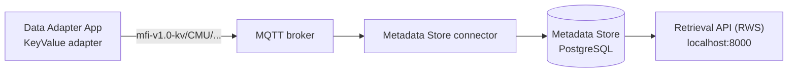

# Getting Started: Users, Projects and Trials

This guide shows how to set up the Metadata Store so that people can stream data and find it again later. You will:

1. [Add a user](#step-1-add-a-user)
2. [Create a project and make that user its admin](#step-2-create-a-project-and-make-the-user-its-admin)
3. [Stream data as that user](#step-3-stream-data-as-that-user) (this creates a *trial*)
4. [Find the trial's recorded start and end times](#step-4-find-the-trials-recorded-times)
5. [Tag the trial to the project](#step-5-tag-the-trial-to-the-project)
6. [Check who can see the trial](#step-6-check-who-can-see-the-trial)

Everything is done from the Data Adapter App ([http://localhost:3001](http://localhost:3001)). No code is needed.

<!-- [!IMPORTANT]
> Complete [Getting Started With MFI DDB](./GettingStarted.md) first, so the Docker services are running and you have seen the Data Adapter App.
-->
## How it works

Users, projects and tags are not created through a web form. They are **messages** sent over MQTT, exactly like data. The Metadata Store connector listens for them and writes them to the database.



To send a message you create a **KeyValue** connection in the Data Adapter App. The message goes in the Adapter Config. Once the connection shows as streaming, the message has been sent, and you can delete the connection.

## Key concepts

| Term | Meaning |
|---|---|
| **User** | A person, identified by `user_id` **and** `domain` together (e.g. `jdoe` + `cmu`). A user must exist before they can stream data. |
| **superadmin** | Built-in user (`user_id: superadmin`, `domain: superadmin`) created when the database is first set up. Use it to create the first users and projects. |
| **Project** | A group of trials, identified by `project_name`. People are added to a project with a role. |
| **Role** | What someone can do in a project: `admin` or `maintainer` (manage the project, see all its trials), or `operator` or `researcher` (see only their own trials). |
| **Trial** | One streaming session. It starts when a connection starts streaming and ends when it stops. Its name is the `trial_id` in the Adapter Config, and its owner is the `user` in the Streamer Config. |
| **Tag** | A link from a trial to a project. Trials are **not** linked to a project automatically. You tag them afterwards. |

### Who can do what

| Action | Who can do it |
|---|---|
| Add a user | Any existing user, usually `superadmin` or a project admin |
| Create a new project | Any existing user |
| Change an existing project or add people to it | `superadmin`, or an `admin`/`maintainer` of that project |
| Stream data (create a trial) | Any user who already exists |
| Tag a trial to a project | The trial's owner, or anyone with any role in that project |
| See a trial in the Retrieval API | The trial's owner, `admin`/`maintainer` of the project it is tagged to, or `superadmin` |

### The Streamer Config for metadata messages

Every step uses this Streamer Config. Only the `user` changes: it is **who is sending the message**.

```yaml
topic_family: kv
user:
  user_id: superadmin      # who is sending this message
  domain: superadmin
mqtt:
  broker_address: mqtt-broker
  broker_port: 1883
  enterprise: CMU
  site: Test-Site
```

> [!WARNING]
> * `enterprise` must be `CMU`. The connector only listens to `mfi-v1.0-kv/CMU/#` (set in [`metadata-rws/mds-broker.ini`](./metadata-rws/mds-broker.ini)). Messages for any other enterprise are silently ignored.
> * `broker_address` is `mqtt-broker` because the Data Adapter App runs inside Docker. Use `localhost` only when you stream from a script on your own computer.

### Sending a message

1. In the Data Adapter App, click **+ New Adapter** and select **KeyValue**.
2. Paste the step's **Adapter Config** and the **Streamer Config** above (with the right `user`).
3. Click **Save**. When the connection shows as streaming, the message has been sent. Check the connector log.
4. Delete the connection.

> [!NOTE]
> * `trial_id` is required in every KeyValue Adapter Config, even though the help text says it is optional. For metadata messages it is just a label. This guide uses `metadata-setup`.
> * Each KeyValue connection is itself recorded as a short trial named after that `trial_id`, owned by the sender. These `metadata-setup` trials are harmless.
> * Timestamps are ISO 8601 in UTC, in quotes, for example `"2026-10-20T15:00:00Z"`. Use the current time.

## Step 1: Add a user

Send this as `superadmin`:

**Adapter Config**
```yaml
trial_id: metadata-setup
payloads:
  - msg_type: user
    user_id: jdoe
    domain: ANDREW
    name: Jane Doe
    email: jdoe@andrew.cmu.edu
    created_by_user_id: superadmin
    created_by_domain: superadmin
    timestamp: "2026-10-20T15:00:00Z"
```

`created_by_user_id`/`created_by_domain` must be a user that already exists. It does not have to match the Streamer Config `user`, but keep them the same to avoid confusion.

<!--**Check it worked:**

```
docker exec mfi-metadata-store-db psql -U mfi -d mds -c "select user_id, domain, name, created_by_user_id from ddb_user;"
```

```
  user_id   |   domain   |    name     | created_by_user_id
------------+------------+-------------+--------------------
 superadmin | superadmin | Super Admin |
 jdoe       | cmu        | Jane Doe    | superadmin
```
-->
## Step 2: Create a project and make the user its admin

Send this as `superadmin`. The project is created, and everyone listed in `user_roles` is added to it with that role:

**Adapter Config**
```yaml
trial_id: metadata-setup
payloads:
  - msg_type: project
    project_name: Aerosol Printing
    description: Print quality study      # optional; any extra keys are stored as project details
    user_roles:
      - user_id: jdoe
        domain: ANDREW
        role: admin                       # admin, maintainer, operator or researcher
    created_by_user_id: superadmin
    created_by_domain: superadmin
    timestamp: "2026-10-20T15:05:00Z"
```

> [!WARNING]
> * Every user in `user_roles` must already exist (Step 1). Otherwise their role is not saved.
> * Choose roles carefully. Once someone has a role in a project, it cannot be changed by sending another message. See [Changing or removing a role](#changing-or-removing-a-role).
> * Sending a `project` message with a name that does not exist yet creates a **new** project, so watch for typos in `project_name`.

<!--**Check it worked:**

```
docker exec mfi-metadata-store-db psql -U mfi -d mds -c "select p.project_name, r.user_id, r.domain, r.role from user_project_role_linking r join project p using (project_id);"
```

```
   project_name   | user_id | domain | role
------------------+---------+--------+-------
 Aerosol Printing | jdoe    | ANDREW    | admin
```
-->
## Step 3: Stream data as that user

Stream some data as the user from Step 1. This guide uses the **KeyValue** adapter with `msg_type: data` payloads, so you don't need a device or an outside broker. Any other adapter works the same way, as in [Getting Started With MFI DDB](./GettingStarted.md#setting-up-a-connection-data-adapter-app), with two changes:

* Set `trial_id` in the **Adapter Config** to a name for this run, e.g. `print_run_001`.
* Set `user` in the **Streamer Config** to the user from Step 1.

**Adapter Config**
```yaml
trial_id: print_run_001          # the trial name; required for data payloads
payloads:
  - msg_type: data
    operator: jdoe
    material: silver_ink
    nozzle_diameter_um: 150
    notes: first print test
  - msg_type: data
    operator: jdoe
    material: silver_ink
    nozzle_diameter_um: 200
    notes: second print test
```

Each `data` payload is a set of key/value pairs that you choose. The adapter sends one payload per poll, so at the default 1 Hz the two payloads above are sent within about two seconds.

**Streamer Config**
```yaml
topic_family: kv
user:
  user_id: jdoe
  domain: ANDREW
mqtt:
  broker_address: mqtt-broker
  broker_port: 1883
  enterprise: CMU
  site: Test-Site
```

The trial starts when the connection starts streaming. Once the payloads have been sent, **Stop** the connection. That records the trial's end time.

> [!WARNING]
> * The user **must exist before you stream**. If they don't, the app still shows the connection as streaming, but no trial is recorded. The only sign is an error in the connector log: `Key (user_id, user_domain)=(jdoe, ANDREW) is not present in table "ddb_user"`.
> * `trial_id` must be set. Without it, `data` payloads are dropped and the only sign is the warning `No trial_id provided` in the Data Adapter App backend log (`docker logs mfi-data-adapter-backend`).
> * After all payloads are sent, the backend log repeats `Data not found for device data` until you stop the connection. This is expected.
> * Adding `project:` to the Streamer Config does **not** link the trial to a project. Use a tag (Step 5).

## Step 4: Find the trial's recorded times

To tag a trial you give a time window, and the trial's **recorded** start and end must both fall inside it. Look them up first.

Retrieval API.** Open [http://localhost:8000/docs](http://localhost:8000/docs), expand **POST /mfi-ddb/type1**, click **Try it out** and send:

```json
{
  "user_id": "jdoe",
  "user_domain": "cmu",
  "trial_id": "print_run_001",
  "time_start": "2026-10-19T00:00:00Z",
  "time_end": "2026-10-21T00:00:00Z"
}
```

The response lists `birth_timestamp` (start) and `death_timestamp` (end) for each trial with that name.
<!--
**Option B: database.**

```
docker exec mfi-metadata-store-db psql -U mfi -d mds -c "select trial_name, user_id, birth_timestamp, death_timestamp from trial where trial_name = 'print_run_001';"
```
-->
> [!CAUTION]
> Use the times **as recorded**, not the times on your clock. When the streamer runs in a timezone other than UTC, its local time is recorded as if it were UTC. For example, a run started at 12:57 in New York (16:57 UTC) is recorded as `12:57+00`. A tag built from your clock would then miss the trial.

> [!TIP]
> * If you reuse the same `trial_id` for several runs, each run is a separate trial. Pick a window that contains only the run you want to tag. If more than one trial matches, the tag is not applied.
> * In the Retrieval API, use full ISO timestamps. The value `"now"` is not accepted.

## Step 5: Tag the trial to the project

Send this as the trial's owner (`jdoe`). Set `time_start` and `time_end` to cover the recorded times from Step 4, with about a minute to spare on each side:

**Streamer Config**: the template from [Before you start](#the-streamer-config-for-metadata-messages) with `user_id: jdoe`, `domain: cmu`.

**Adapter Config**
```yaml
trial_id: metadata-setup
payloads:
  - msg_type: tp-tag
    trial_id: print_run_001               # the trial to tag
    trial_user_id: jdoe                   # the trial's owner (who streamed it)
    trial_user_domain: cmu
    project_name: Aerosol Printing
    time_start: "2026-10-20T16:53:30Z"    # recorded start minus about 1 minute
    time_end: "2026-10-20T16:55:40Z"      # recorded end plus about 1 minute
    created_by_user_id: jdoe              # who is tagging: the owner or anyone with a role in the project
    created_by_domain: cmu
    timestamp: "2026-10-20T17:00:00Z"
```

The top-level `trial_id: metadata-setup` is only the label for this KeyValue connection. The trial being tagged is the `trial_id` **inside** the payload.

<!--**Check it worked:**

```
docker exec mfi-metadata-store-db psql -U mfi -d mds -c "select t.trial_name, t.user_id, p.project_name from trial t left join project p using (project_id) where t.trial_name = 'print_run_001';"
```

```
  trial_name   | user_id |   project_name
---------------+---------+------------------
 print_run_001 | jdoe    | Aerosol Printing
```
-->
## Step 6: Check who can see the trial

In [http://localhost:8000/docs](http://localhost:8000/docs), run **POST /mfi-ddb/type1** with the project name:

```json
{
  "user_id": "jdoe",
  "user_domain": "cmu",
  "project_name": "Aerosol Printing",
  "time_start": "2026-10-19T00:00:00Z",
  "time_end": "2026-10-21T00:00:00Z"
}
```

```json
{
  "status": "success",
  "message": "Found 1 trial(s).",
  "trials": [
    {
      "trial_name": "print_run_001",
      "project_id": "da555019-973e-43b9-a253-476f6c830e2c",
      "birth_timestamp": "2026-10-20T16:54:33.525353+00:00",
      "death_timestamp": "2026-10-20T16:54:40.588627+00:00",
      "...": "..."
    }
  ]
}
```

Tagged trials have a `project_id`. (The response's `project_name` field is currently always empty, so go by `project_id`.)

Tagging is what lets the project's admins find trials that **other people** streamed. For a trial tagged to *Aerosol Printing*:

| Who is asking | Sees the trial? |
|---|---|
| The person who streamed it | Yes (always, tagged or not) |
| An `admin` or `maintainer` of *Aerosol Printing* | Yes |
| An `operator` or `researcher` of *Aerosol Printing* | Only their own trials |
| `superadmin` | Yes |
| Anyone else | No |

## Adding more people to a project

A project admin can add people without `superadmin`. Send both messages **as the admin** (Streamer Config `user` = `jdoe`/`cmu`).

1. Create the user, if they don't exist yet:

   ```yaml
   trial_id: metadata-setup
   payloads:
     - msg_type: user
       user_id: bsmith
       domain: cmu
       name: Bob Smith
       created_by_user_id: jdoe
       created_by_domain: cmu
       timestamp: "2026-10-20T15:10:00Z"
   ```

2. Add them to the project. Send a `project` message with the **existing** project name:

   ```yaml
   trial_id: metadata-setup
   payloads:
     - msg_type: project
       project_name: Aerosol Printing
       user_roles:
         - user_id: bsmith
           domain: cmu
           role: operator
       created_by_user_id: jdoe          # must be admin or maintainer of this project
       created_by_domain: cmu
       timestamp: "2026-10-20T15:11:00Z"
   ```

`bsmith` can now stream trials and tag them to *Aerosol Printing*. As an `operator`, they see only their own trials. The admin `jdoe` sees all trials tagged to the project, including `bsmith`'s.

## Changing or removing a role

There is no message for changing or removing a role. Sending a second `project` message for someone who already has a role fails, and the connector logs `duplicate key value violates unique constraint "unique_user_project_role"`.

Until this is supported, a database administrator can change it directly:

```
docker exec mfi-metadata-store-db psql -U mfi -d mds -c "update user_project_role_linking set role = 'maintainer' where user_id = 'bsmith' and domain = 'cmu' and project_id = (select project_id from project where project_name = 'Aerosol Printing');"
```

To remove someone from a project, replace the `update ... set role = 'maintainer'` part with `delete from user_project_role_linking`, keeping the same `where` clause.

## Troubleshooting

Look at the connector log first (`docker logs mfi-metadata-store-connector`).

| What you see | Likely cause | Fix |
|---|---|---|
| Nothing in the connector log after sending | Wrong `enterprise`, `broker_address` or `topic_family` in the Streamer Config | Use the [Streamer Config template](#the-streamer-config-for-metadata-messages): `enterprise: CMU`, `broker_address: mqtt-broker`, `topic_family: kv` |
| App says `Invalid configuration for adapter or streamer` | `trial_id` missing from the KeyValue Adapter Config, or a required field missing from the payload | Add `trial_id: metadata-setup`. Every payload needs `created_by_user_id`, `created_by_domain` and `timestamp` |
| Streaming works but no trial is recorded; log shows `is not present in table "ddb_user"` | The Streamer Config `user` doesn't exist | Add the user (Step 1), then stream again |
| `Cannot update the tag for the trial ...` | No trial, or more than one, matches the name, owner and time window | Check the recorded times (Step 4), `trial_user_id`/`trial_user_domain` and the window |
| `User ... not authorized to update trial ...` | The person tagging is neither the trial's owner nor in the project | Tag as the owner, or add the person to the project first |
| `User ... not allowed to update project ...` | Someone who isn't `admin`/`maintainer` of the project tried to change it or add people | Send as a project admin or `superadmin` |
| `duplicate key value violates unique constraint "unique_user_project_role"` | The person already has a role in that project | See [Changing or removing a role](#changing-or-removing-a-role) |
| Retrieval API returns `Invalid time_end: now` | `"now"` isn't accepted | Use an ISO timestamp such as `"2026-10-21T00:00:00Z"` |
| Trial tagged, but a teammate can't find it | They are an `operator`/`researcher`, who only see their own trials | Give them `admin` or `maintainer` if they need to see everyone's trials |

## Reference

* Message format for `user`, `project` and `tp-tag`: [`kv.json`](../mfi_ddb_package/src/mfi_ddb/topic_families/schema/kv.json)
* Database tables: [Metadata Store README](../mfi_ddb_retrieval_api/metadata_store_pg/README.md)
* How messages are processed: [`connector.py`](../mfi_ddb_retrieval_api/metadata_store_pg/connector.py)
* Retrieval API endpoints: [http://localhost:8000/docs](http://localhost:8000/docs)
